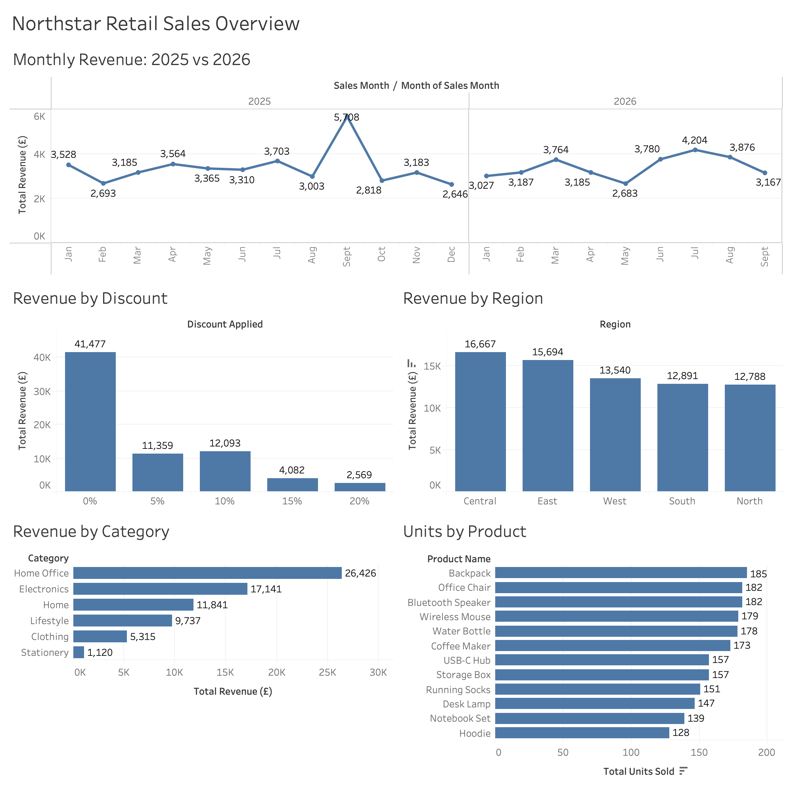

# Northstar Retail Sales Dashboard

Tableau dashboard analysing retail sales by month, category, region, discount and product.

## Objective
To analyse retail sales performance, identify revenue trends, evaluate discount performance and identify the strongest products and regions

## Questions answered
- How has monthly revenue changed between 2025 and 2026?
- Which categories, regions and products perform best?
- How much revenue comes from each discount level?

## Key findings
- Total revenue across the period: £71,579
- Sales with no discount bring in £41,477, over half of total revenue
- Home Office is the top category (£26,426)
- Central is the top region (£16,667)
- Backpack is the best-selling product (185 units)

## Recommended business actions
1. Sales with no discount generated £41,477 of revenue, around 58% of total revenue. Avoid offering discounts automatically on every product. Test targeted promotions on selected products and compare revenue, units sold and profit against sales without discounts. The company could reduce unnecessary discounting while maintaining sales and protecting profit margins.
2. Backpacks were the best-selling product by units, with 185 sold. Review backpack stock levels, sales trends and profit margins. If demand remains strong, maintain appropriate stock levels and consider testing complementary product bundles. This could help reduce lost sales from stock shortages and identify opportunities to increase basket value.
3. Home Office generated the highest category revenue at £26,426. Investigate which Home Office products contribute most to revenue and profit. Consider targeted marketing and complementary product offers for customers buying these products. The retailer could build on an established revenue source while identifying opportunities for profitable growth.
4. The Central region generated the highest revenue at £16,667. Investigate which products, customer groups and sales channels drive Central's performance. Compare these with other regions to identify practices that could be replicated elsewhere. This could help the business identify regional growth opportunities and allocate marketing resources more effectively.
5. Your Tableau dashboard compares monthly revenue across 2025 and 2026. Monitor month-on-month revenue and compare the same months across both years. Investigate unusually high or low months and account for seasonality before changing stock or marketing plans. This could improve sales forecasting, stock planning and the timing of promotional campaigns.

## Tools
Tableau, Excel, Google BigQuery (SQL)

## Data preparation
Queried and aggregated the sales data in Google BigQuery using SQL, then exported the results to Excel and visualised them in Tableau.

## Files
- `Northstar Retail Sales.twbx`: Tableau packaged workbook
- `Northstar_Retail_Sales.xlsx`: source data
- `Dashboard.png`: dashboard preview

## Notes
2026 data runs to September, so the full years are not directly comparable.
